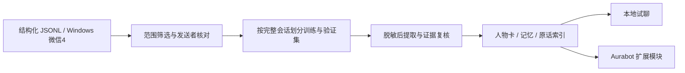

# WeChat Persona Skill

从本人或获授权的聊天记录中提取**有来源的记忆、说话习惯与情境行为规律**，生成可试聊的人物模拟资料，并可接入 [Aurabot](https://github.com/aureth-labs/dsh-aurabot-qq)。

仓库只包含通用代码、skill、测试和虚构示例，不包含真实人物资料、聊天记录、账号或密钥。



## 能做什么

- 通过规范化JSONL导入跨平台使用；Windows可选读取当前用户已登录的微信4本地库。
- 将双方私聊与目标人物的群发言分开，按消息所在分片核对发送者。
- 在内存中解密、验证数据库页面及WAL已提交帧，不保存完整明文库或读取密钥。
- 分批提取并核对证据，保留来源ID、获知时间、计划/事件区别与可见范围；支持断点恢复。
- 使用同一套检索与角色规则进行本地试聊和Aurabot接入；私人资料只进入配置用户的私聊。
- 新对话中的 `/人设记住 事实` 独立存储，不改写原型历史。

人物模拟不能代表真人当前的想法或行动。自动证据核对会有误判，需要人工审阅；预留验证集也不等于已证明人物相似度。当前不转写语音、不推测图片内容、不训练或发布模型权重。

## 环境

- Python 3.12+、Node.js 22.13+（本地验证使用Node.js 24）。
- JSONL导入、离线演示和测试可在Windows/Linux运行。
- 直接读取微信进程只支持Windows；其布局曾在微信4.1.15.56中验证，不保证其他版本兼容。失败时停止，不放宽校验。
- 模型阶段使用DeepSeek/OpenAI格式兼容的Chat Completions接口；需要服务支持JSON对象输出及当前请求参数。其他服务的参数可能需要适配。
- QQ接入是可选步骤，需要用户自行安装DSH、Aurabot和OneBot v11网关，并自行完成登录。

## 先跑无网络演示

```sh
python -m venv .venv
```

激活环境：Windows PowerShell运行 `.\.venv\Scripts\Activate.ps1`；Linux/macOS运行 `source .venv/bin/activate`。随后：

```sh
python -m pip install -r requirements.txt
python scripts/demo.py
python scripts/chat.py --project .demo/project.json --message Coffee --offline
```

演示仅在被Git忽略的 `.demo/` 中生成虚构人物和来源片段；不读微信、不使用API、不接入QQ。最后一条命令展示检索材料，不假装是模型生成的聊天回复。

## 使用自己的数据

复制 `project.example.json` 为被忽略的 `project.json`，填写以下内容：

| 字段 | 含义 |
| --- | --- |
| `name` / `persona_id` | 模拟角色名与小写文件标识 |
| `source_account` | 当前用户在源数据中的内部账号 |
| `target_username` / `target_remark` | 原型的内部账号与用于核对的备注 |
| `source_root` | 直接读取时的 `db_storage` 路径；JSONL入口可留空 |
| `include_group_target_messages` | 是否纳入目标本人群发言，默认关闭 |
| `owner_qq` / `bot_qq` | 接入QQ或本地权限预览使用的身份；线上安装要求有效且不同的QQ号 |
| `api_base` / `model` | 模型服务地址和模型名 |
| `external_analysis_authorized` | 是否允许向所选服务发送范围内的文本，默认关闭 |

### 入口A：已有JSONL

每行一个对象，必需字段为 `conversation`、`sender`、`timestamp`（Unix秒）和 `text`；`id`、`type`、`sort_seq`、`server_id`可选。`type`默认1表示文本。私聊的 `conversation` 是目标账号，群聊以 `@chatroom` 结尾。示例均为虚构：

```json
{"id":"demo-1","conversation":"wxid_demo_target","sender":"wxid_demo_target","timestamp":1700000000,"type":1,"text":"我喜欢手冲Coffee"}
```

完整小样见 [examples/messages.example.jsonl](examples/messages.example.jsonl)。发送者布尔标记由导入器重新计算，不信任输入中的 `is_target`。未获准群消息及其他私聊会被排除。

```sh
python scripts/import_jsonl.py --project project.json --input path/to/export.jsonl
```

### 入口B：Windows微信4本地库

保持本人微信已登录，显式配置账号与 `source_root` 后运行：

```sh
python skills/wechat-persona/scripts/extract.py --project project.json
```

它只读打开源文件和微信进程，以所选库的页面HMAC验证读取材料，并核对备注与内部账号。它不是账号登录、密码恢复或跨设备取证工具。

### 提取、核对和建立索引

先在终端设置 `DEEPSEEK_API_KEY`，不要写进项目配置或命令示例。Windows可设置 `$env:DEEPSEEK_API_KEY`，其他平台使用 `export`。`.env.example`仅作字段说明，程序不自动读取`.env`。

了解发送范围与服务条款后，**自行**将 `external_analysis_authorized` 改为 `true`。如需复用已有DSH配置，还须显式设置 `use_dsh_credentials: true`；默认不会读取其密钥。

```sh
python skills/wechat-persona/scripts/build.py --project project.json
python skills/wechat-persona/scripts/audit.py --project project.json
python skills/wechat-persona/scripts/episodes.py --project project.json
python skills/wechat-persona/scripts/psychology.py --project project.json
python scripts/chat.py --project project.json
```

主要产物位于配置文件同目录的 `output/`：

| 文件 | 内容 |
| --- | --- |
| `persona.md` / `profile.json` | 可读人物卡与结构化规律 |
| `memories.json` | 通过自动证据核对的候选记忆 |
| `examples.json` / `episodes.json` | 表达示例与可检索原话片段 |
| `build-report.json` | 提取范围、统计与验证集隔离信息 |

`data/evidence.json`用于按证据ID回查来源。`data/`、`output/`及用户配置包含私人资料，均不应公开。

`behavior-model.json`进一步保留私聊/群聊及可观察情境下的表达分布、规律支持的会话数和目标本人事件时间线；单会话观察不会写成稳定人格。它不生成心理量表分数。设计依据与证据边界见 [研究笔记](docs/research.md)。

本地试聊按完整轮次保留近期上下文，并将新对话原话保存在被忽略的 `data/conversation-memory/`；关闭后重开仍可检索早期片段。“那后来呢”可借用前几轮线索。新对话与微信历史、不同人格与聊天分别隔离；机器人曾说过的话保持assistant标记，不能自动作为真人经历。检索证据和近期对话分别有长度预算，预算不足时舍弃完整记录。

## 接入Aurabot

按[Aurabot官方说明](https://github.com/aureth-labs/dsh-aurabot-qq)安装DSH插件与网关，亲自完成QQ扫码及协议确认。此仓库不分发网关、不代替接受协议，也不自动上线。

在配置中填写两个不同的真实QQ号并重新构建资料后，先查看安装计划：

```sh
node scripts/install-aurabot.mjs --project project.json
```

计划会说明切换人格、关闭发送、关闭内置动作、使用纯聊天权限及备份配置。确认符合需求后应用：

```sh
node scripts/install-aurabot.mjs --project project.json --apply
```

关闭DSH后安装、再重启DSH最直接；若需更新正在运行的本机DSH，可额外加 `--reload`。安装器只允许回环地址，完整暂存并切换资料包，避免人物身份与私人记忆混装。仅支持一个活动的 `wechat-persona` 扩展；不同人格的新对话记忆按人格ID分开。

在Aurabot面板确认身份和试运行结果，再按自己的授权范围启用聊天。**模型服务授权不等于QQ发送授权。**

希望同时增强Aurabot本体的对话记忆时，参见 [核心补丁说明](docs/aurabot-core.md)。人物扩展可以单独使用；本体补丁有明确的上游版本要求，需要重新加载核心。

## 作为skill使用

[skills/wechat-persona/SKILL.md](skills/wechat-persona/SKILL.md)包含工作流与约束。提取脚本可独立随技能使用；JSONL便捷入口、本地试聊和Aurabot安装使用本仓库源码。保留已有同名私人skill，避免未经备份覆盖。

## 测试与发布检查

```sh
python -B -m unittest discover -s tests -p "test_*.py"
node --test tests/runtime.test.mjs
python scripts/check_public.py
```

最后一条检查Git已跟踪/暂存文件；它拒绝运行数据、数据库、非演示账号和常见凭证格式，并只报告位置，不回显密钥。它是辅助检查，不能发现所有隐私。提交前仍应执行 `git diff --cached` 人工检查。

CI配置包含Windows/Linux、Python 3.12/3.13、Node.js 24；远程CI结果需在推送后确认。测试与演示不需要API密钥或真实微信数据。

可用 `python scripts/evaluate.py --project project.json --cases 6 --baseline-ref v0.1.0` 检查预留会话的检索隔离（需本地存在对应旧版tag，也可指定旧提交）；加 `--generate` 才会调用已获授权的模型，生成旧版/新版续写并进行标签置换后的自动评审。报告保存在私人 `data/` 下，不写入真实聊天记忆。自动评审样本少且有偏差，不能替代熟悉原型的人的盲评。

参见 [PRIVACY.md](PRIVACY.md)、[SECURITY.md](SECURITY.md) 和 [CONTRIBUTING.md](CONTRIBUTING.md)。

## 许可证与来源

代码采用 [Apache-2.0](LICENSE)。读取实现的参考与改动说明见 [NOTICE](NOTICE)；Aurabot作为外部MIT依赖，其许可证副本在 [third_party/Aurabot-MIT.txt](third_party/Aurabot-MIT.txt)。代码许可证不包含任何聊天记录、人物肖像、声音或身份资料的使用授权。
