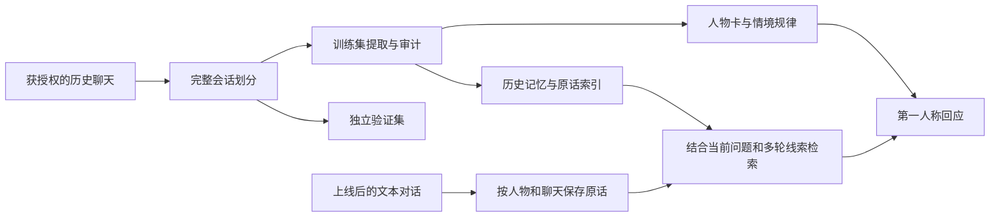

# WeChat Persona Skill

**从获授权的聊天记录构建人物模拟角色：有来源的记忆、按情境变化的表达，以及能够延续的新对话。**

[](https://github.com/Accelerate11/wechat-persona-skill/actions/workflows/ci.yml)

本项目将聊天记录整理为人物卡、表达规律、记忆和原话索引。角色以第一人称自然聊天，历史事实保留来源、时间与说话者；上线后的对话另行保存，后续可以重新检索。

可以先在本地试聊，再接入 [Aurabot](https://github.com/aureth-labs/dsh-aurabot-qq)。需要同时增强 QQ 聊天中枢时，可使用配套的 [Aurabot 记忆增强分支](https://github.com/Accelerate11/dsh-aurabot-qq-memory/tree/persona-memory)。

仓库提供通用代码、skill 和虚构示例。真实人物资料、聊天记录、账号配置与密钥保留在使用者本地。

## 已实现的能力

| 能力 | 实现方式 |
| --- | --- |
| 语料导入 | 支持规范化 JSONL；Windows 可选只读提取当前已登录微信 4 的指定联系人语料 |
| 发送者与范围核对 | 私聊保留双方上下文；群聊仅保留获准的目标本人发言 |
| 有来源的记忆 | 附证据 ID、获知时间、主体和可见范围，区分计划、转述与已发生事件 |
| 情境人格 | 记录“在什么情况下如何回应”，统计表达分布和支持会话数，保留反例与未知 |
| 第一人称角色 | 将有依据的本人历史融入角色视角，避免机械复读口头禅或补写未提供的经历 |
| 持久对话 | 新对话按人格与聊天隔离保存原话，重新启动后仍可检索较早内容 |
| 多轮上下文 | “那后来呢”等省略说法可借助前几轮线索；明确新话题优先 |
| 检索预算 | 按完整消息拆分片段，超长粘贴不会让相邻的小事实一并漏检 |
| 可检查的评估 | 完整会话验证集隔离，支持旧版/新版续写对照和自动盲评 |
| QQ 接入 | 独立人物扩展；安装默认先关闭发送和内置动作，提供配置备份 |

这是人物模拟与记忆系统，不训练或发布模型权重。心理学研究用于指导设计，不能证明已恢复一个人的完整人格。角色直接被问真实身份时应如实说明模拟身份。

## 先运行离线演示

需要 **Python 3.12+** 和 **Node.js 22.13+**。当前 CI 使用 Windows/Linux、Python 3.12/3.13 和 Node.js 24。

```sh
git clone https://github.com/Accelerate11/wechat-persona-skill.git
cd wechat-persona-skill
python -m venv .venv
```

激活虚拟环境：

| 终端 | 命令 |
| --- | --- |
| Windows PowerShell | `.\.venv\Scripts\Activate.ps1` |
| Linux/macOS | `source .venv/bin/activate` |

随后运行：

```sh
python -m pip install -r requirements.txt
python scripts/demo.py
python scripts/chat.py --project .demo/project.json --message Coffee --offline
```

演示只在被 Git 忽略的 `.demo/` 中生成虚构人物与语料，不读取微信、不调用模型、不连接 QQ。最后一条命令显示检索结果，便于先检查数据流。

## 使用自己的聊天记录

### 1. 创建项目配置

将 `project.example.json` 复制为 `project.json`，按实际数据填写：

| 配置 | 用途 |
| --- | --- |
| `name`、`persona_id` | 角色名与独立人物标识 |
| `source_account` | 当前用户在源数据中的内部账号 |
| `target_username`、`target_remark` | 原型人物的内部账号与核对备注 |
| `source_root` | 微信直接提取时的 `db_storage` 路径；JSONL 导入可留空 |
| `include_group_target_messages` | 是否包含目标本人群发言，默认关闭 |
| `owner_qq`、`bot_qq` | 使用者与机器人身份；QQ 安装时须为有效且不同的账号 |
| `api_base`、`model` | 模型服务地址与模型名 |
| `external_analysis_authorized` | 是否允许向选定模型服务发送文本，默认关闭 |

`project.json`、`data/` 和 `output/` 均用于私人运行数据，不应提交到 Git。

### 2. 选择语料入口

**已有 JSONL：**

```sh
python scripts/import_jsonl.py --project project.json --input path/to/export.jsonl
```

每行包含 `conversation`、`sender`、Unix 秒时间戳 `timestamp` 和 `text`；可选 `id`、`type`、`sort_seq`、`server_id`。`type` 默认为文本类型 `1`。私聊的 `conversation` 使用目标内部账号，群聊以 `@chatroom` 结尾。虚构示例：

```json
{"id":"demo-1","conversation":"wxid_demo_target","sender":"wxid_demo_target","timestamp":1700000000,"text":"我喜欢手冲Coffee"}
```

完整样例见 [messages.example.jsonl](examples/messages.example.jsonl)。导入器重新核对发送者，不信任输入的 `is_target` 标记，并排除未获准的聊天范围。

**Windows 微信 4 本地库：**

保持本人微信已登录，配置账号与 `source_root` 后执行：

```sh
python skills/wechat-persona/scripts/extract.py --project project.json
```

提取器只读访问指定数据库和已登录进程，在内存中解密并验证页面与 WAL 提交边界，不落盘保存完整明文库或数据库密钥。布局曾在微信 4.1.15.56 验证；其他版本不保证兼容。

### 3. 提取、审计与试聊

模型阶段需要支持 Chat Completions、JSON 对象输出及当前请求参数的服务；其他兼容服务可能需要适配参数。

在当前终端设置 `DEEPSEEK_API_KEY`。确认发送范围后，由使用者将 `external_analysis_authorized` 设为 `true`。复用已有 DSH 密钥另需显式开启 `use_dsh_credentials`；默认不会读取它，也不会自动加载 `.env`。

```sh
python skills/wechat-persona/scripts/build.py --project project.json
python skills/wechat-persona/scripts/audit.py --project project.json
python skills/wechat-persona/scripts/episodes.py --project project.json
python skills/wechat-persona/scripts/psychology.py --project project.json
python scripts/chat.py --project project.json
```

提取与证据审计支持缓存恢复。`audit.py` 也会生成行为模型；`psychology.py` 可在审计后独立重建该模型，不调用网络。

| 主要产物 | 内容 |
| --- | --- |
| `output/persona.md`、`profile.json` | 人物卡与结构化表达规律 |
| `output/memories.json` | 通过自动证据核对的候选记忆 |
| `output/examples.json`、`episodes.json` | 表达示例与原话检索片段 |
| `output/behavior-model.json` | 表达分布、条件规律支持数与本人事件时间线 |
| `output/build-report.json` | 构建范围、统计和验证集信息 |
| `data/evidence.json` | 按证据 ID 回查来源 |
| `data/conversation-memory/` | 本地试聊的新对话原话日志 |

## 记忆与人物视角



- **历史与新对话分开。** 机器人曾说过的话保留 `assistant` 来源，不自动成为原型或用户经历的证据。
- **规律带情境与支持数。** 单会话观察降级，不把一次玩笑、短暂情绪或消息长度直接换成人格分数。
- **原话可回查。** 总结和行为概括保留证据引用，未检索到的经历保持未知。
- **上下文有预算。** 保留完整近期轮次，按问题取回较早片段；片段预算不等于整个模型请求的 token 上限。

研究来源、阅读范围和工程推断见 [研究笔记](docs/research.md)。

## 接入 QQ

先按 [Aurabot 上游说明](https://github.com/aureth-labs/dsh-aurabot-qq)安装 DSH、Aurabot 和 OneBot v11 网关，并完成本人账号登录与必要协议确认。

人物资料审计完成、账号配置一致后，先查看安装计划：

```sh
node scripts/install-aurabot.mjs --project project.json
```

确认计划后应用：

```sh
node scripts/install-aurabot.mjs --project project.json --apply
```

安装器会备份配置，暂存完整人物资料再切换，并关闭发送与内置动作。重启 DSH 后，在面板核对人物、账号和试运行结果，再按需要恢复在线设置。支持一个活动的 `wechat-persona` 扩展，私人历史只提供给指定用户的私聊。

`/人设记住 事实` 可保存用户明确提供的新事实，与原型历史分开存储。

### 同时增强 Aurabot 核心

原版 Aurabot 可以使用人物扩展；配套 [记忆增强分支](https://github.com/Accelerate11/dsh-aurabot-qq-memory/tree/persona-memory)还会在聊天中枢保留原话、提供多轮检索线索，并加强事实版本与聊天范围处理。

核心安装工具默认只核对包版本、文件哈希并输出计划；显式应用时提供备份与失败回滚。支持的基线和完整命令见 [核心安装说明](docs/aurabot-core.md)。安装新版核心需要重新加载宿主，人物扩展热重载不能替代这一步。

加载后可在本机接口 `/aurabot/api/ext/wechat-persona/status` 核对 `conversationArchive: "aurabot_core"`，并确认 `conversationContext.enabled` 已开启。

## 评估与开发

```sh
python -B -m unittest discover -s tests -p "test_*.py"
node --test tests/runtime.test.mjs
python scripts/check_public.py
```

发布检查读取 Git 暂存区，检查运行数据、账号、路径与常见凭证格式，只报告位置而不回显密钥。它是辅助检查，提交前仍需检查 `git diff --cached`。

预留会话的检索与续写对照：

```sh
python scripts/evaluate.py --project project.json --cases 6 --baseline-ref v0.1.0
```

本地须存在对应旧 tag，也可指定旧提交。默认只检索；加 `--generate` 才调用已授权模型生成两版续写并进行标签置换后的自动评审。报告保存在私人 `data/` 中，不写入真实对话记忆。自动评审不能替代熟悉原型的人的盲评，也不等于已证明真人相似度。

作为 Codex skill 使用时，参见 [SKILL.md](skills/wechat-persona/SKILL.md)。提取脚本可以随技能使用；本地试聊和 QQ 接入需要本仓库的运行代码。

## 文档与许可

- [研究依据](docs/research.md) · [Aurabot 核心安装](docs/aurabot-core.md)
- [隐私说明](PRIVACY.md) · [安全问题](SECURITY.md) · [贡献指南](CONTRIBUTING.md)

通用代码采用 [Apache-2.0](LICENSE)；来源与改动说明见 [NOTICE](NOTICE)。共享的对话索引引擎源文件标注 MIT 许可，Aurabot 上游的 MIT 许可副本见 [third_party/Aurabot-MIT.txt](third_party/Aurabot-MIT.txt)。代码许可不包含任何人的聊天记录、身份、肖像或声音使用权。
